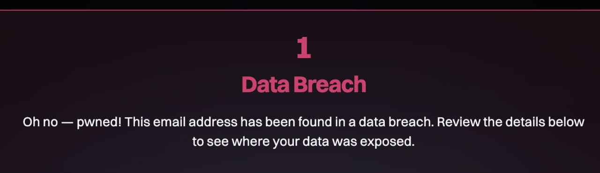
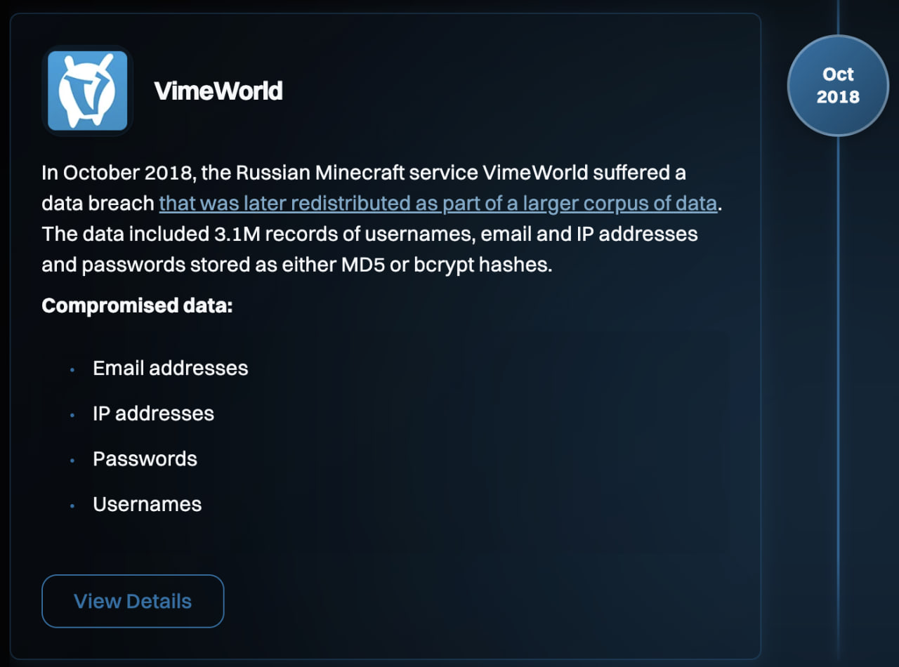
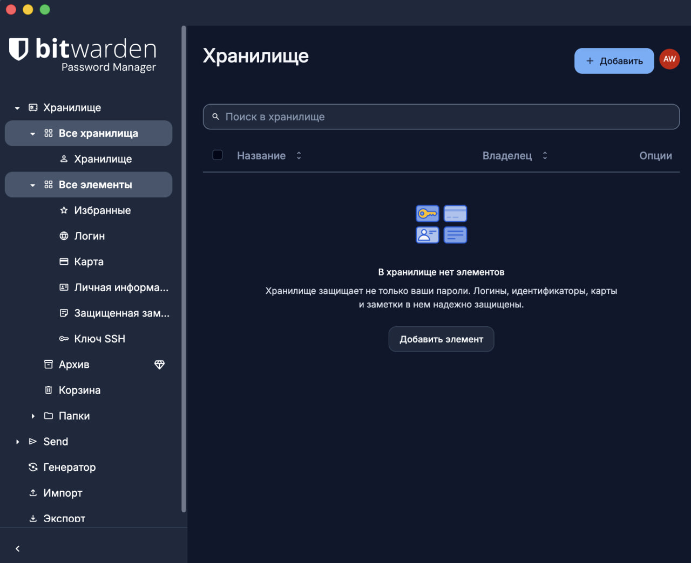
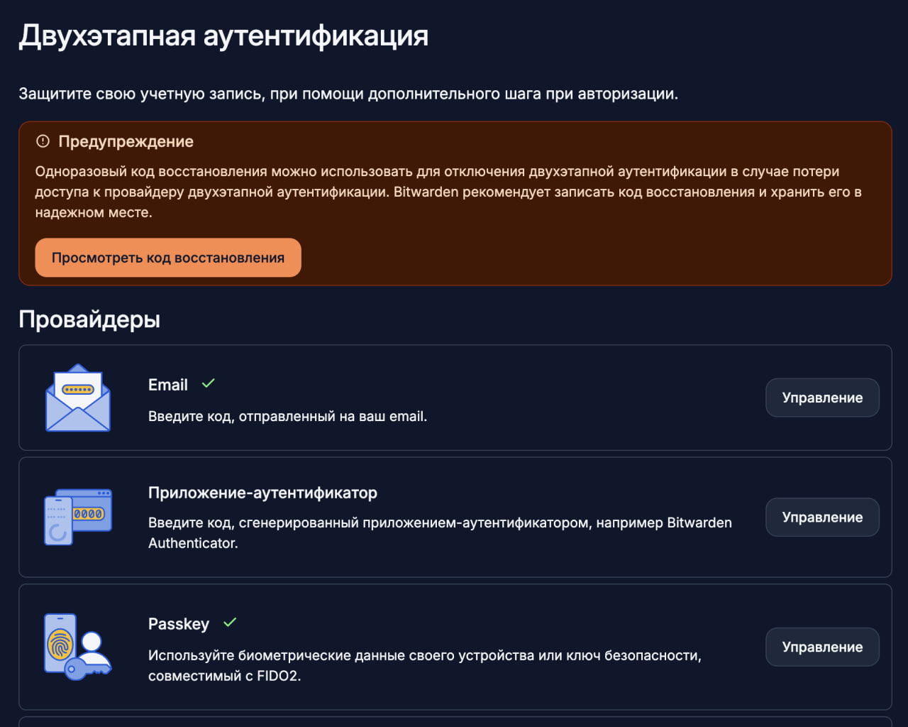
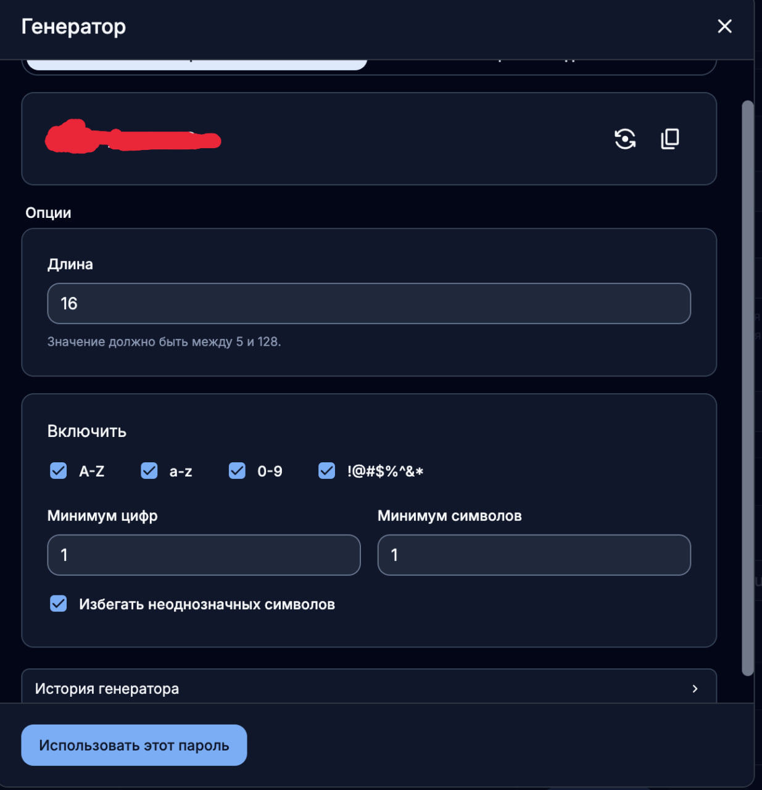
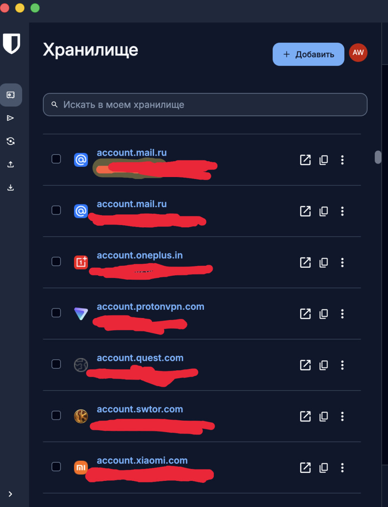
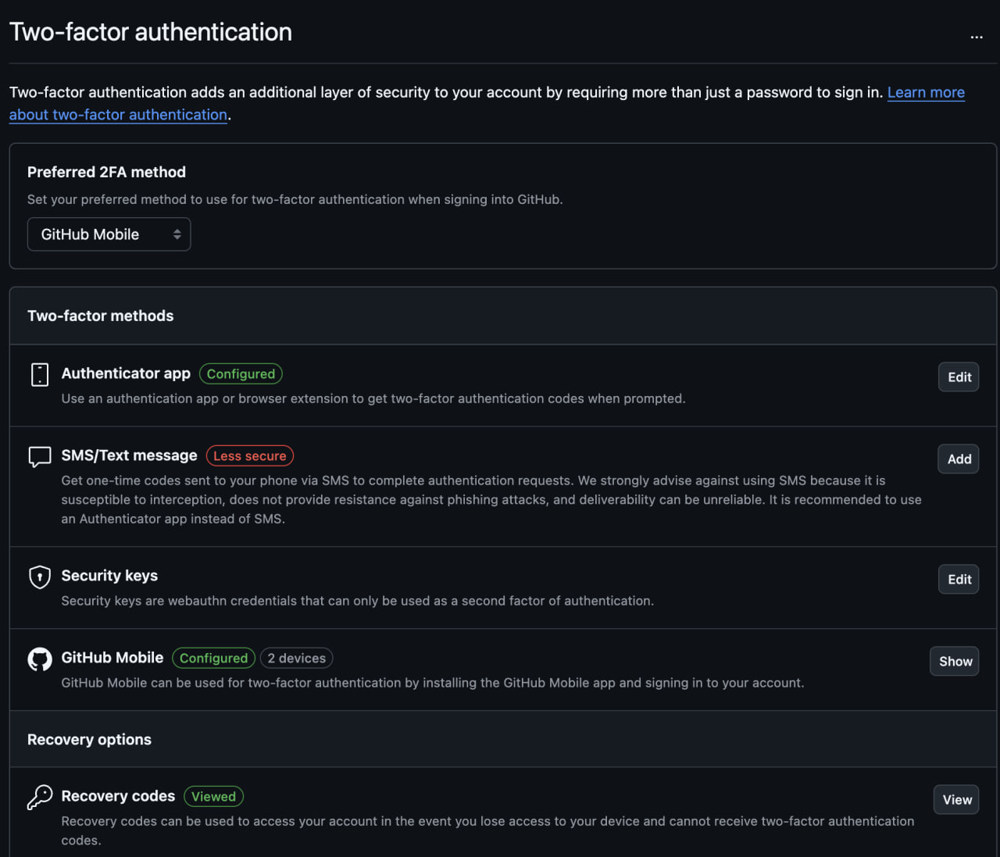
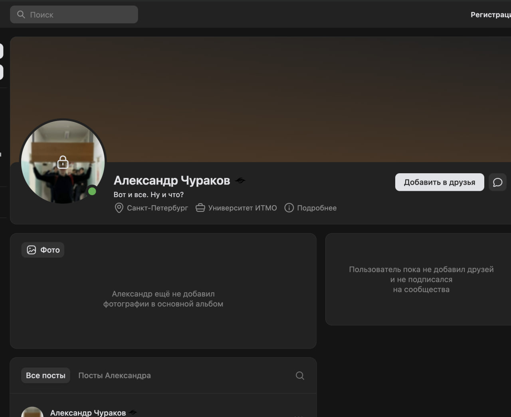
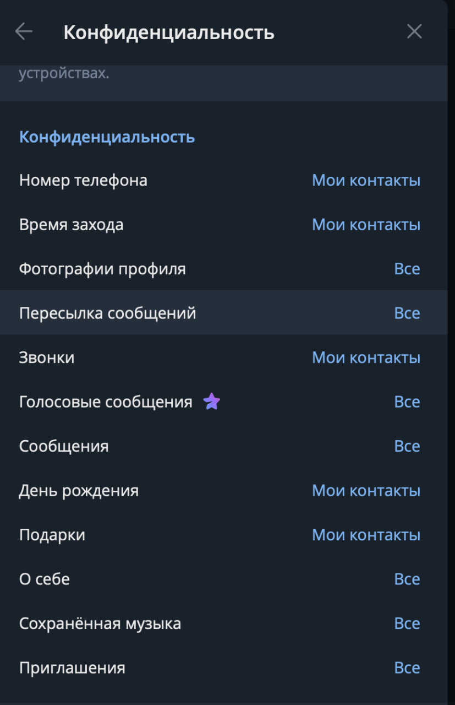

# Работы 5 и 8: аудит паролей и цифровая гигиена

**Университет:** Федеральное государственное автономное образовательное учреждение высшего образования «Национальный исследовательский университет ИТМО»
**Дисциплина:** Информационная безопасность
**Работа 5:** Аудит паролей с помощью менеджера паролей
**Работа 8:** Мини-исследование: утечка данных и цифровая гигиена
**Выполнил:** Чураков Александр Алексеевич
**Группа:** P3431
**Год:** 2026

---

## 1. Проверка email на утечки (работы 5 и 8)

Основной email проверен на [haveibeenpwned.com](https://haveibeenpwned.com). 

Адрес найден в **одной** утечке:

| Сервис | Дата | Объём | Скомпрометированные данные |
|---|---|---|---|
| VimeWorld (игровой сервер Minecraft) | октябрь 2018 | 3,1 млн записей | email, имя пользователя, IP-адрес, пароль (хэш MD5 или bcrypt) |

**Анализ:**
- Утёк хэш пароля. Часть паролей хранилась в **MD5**: это быстрый хэш без соли, такие пароли массово подбираются по словарю за минуты. Утечку стоит считать раскрытием самого пароля.
- Данные были перепроданы в составе большой подборки, поэтому пара «email + пароль» могла попасть в базы для **credential stuffing** - автоматического перебора одной пары логин/пароль на других сайтах.
- Утёк IP-адрес, который позволяет примерно определить город и провайдера.
- **Меры:** аккаунт в VimeWorld не используется. Пароль, который мог использоваться там, больше нигде не применяется. Пароль сменен на новый более надежный из генератора паролей.

## 2. Менеджер паролей Bitwarden (работа 5)

Установлен бесплатный менеджер паролей **Bitwarden**. Создана учётная запись с надёжным мастер-паролем: длинная фраза с цифрами и спецсимволами, нигде больше не используется.

Учётная запись Bitwarden дополнительно защищена двухэтапной аутентификацией: код на email и **passkey** (биометрия устройства / ключ FIDO2). Код восстановления сохранён в надёжном месте.

## 3. Аудит и замена паролей (работа 5)

### Какие пароли были слабыми

Несколько паролей от аккаунтов на неважных сайтах. Были созданы более 10 лет назад в детском возрасте. Например только слово или только цифры, маленькая длина.

Все пароли от аккаунтов на важных или чувствительных сайтах сейчас достаточно сложны - не повторяются, используются буквы, цифры, спецсимволы, длина минимум 10 символов.

### Новые пароли

Для замены использован встроенный генератор Bitwarden: длина **16 символов**, заглавные и строчные буквы, цифры и спецсимволы, без неоднозначных символов.

Пароли заменены на сгенерированные и сохранены в хранилище.

## 4. Двухфакторная аутентификация

Двухфакторная аутентификация с одноразовыми кодами (**TOTP**, приложение-аутентификатор) настроена для аккаунта **GitHub**. Дополнительно подключён вход через приложение GitHub Mobile. Коды восстановления просмотрены и сохранены.

SMS как второй фактор не используется: GitHub сам помечает его как менее безопасный, поскольку SMS можно перехватить или получить через перевыпуск SIM-карты.

### Что такое 2FA

Двухфакторная аутентификация (2FA) - вход, при котором кроме пароля  нужно подтвердить второй фактор другого типа: «то, что у меня есть» (телефон с приложением-аутентификатором, аппаратный ключ) или «то, что я есть» (биометрия).

**TOTP** (Time-based One-Time Password): при настройке сервис и приложение-аутентификатор получают общий секрет (через QR-код). Каждые 30 секунд оба независимо вычисляют из секрета и текущего времени 6-значный код. Код действует один раз и недолго, поэтому даже украденный пароль без доступа к телефону не позволит войти.

## 5. Аудит публичных данных в соцсетях (работа 8)

### ВКонтакте

Профиль проверен без входа в аккаунт, то есть так, как его видит посторонний человек.

| Видно посторонним | Скрыто |
|---|---|
| имя и фамилия, статус, город (Санкт-Петербург), место учёбы (Университет ИТМО), аватар | профиль закрыт, список друзей и подписок, фотоальбомы |

**Вывод:** по имени, городу и ВУЗу легко связать профиль ВК с другими аккаунтами и найти человека. Эти данные удобны для таргетированного фишинга, например письма «от деканата ИТМО». Город и ВУЗ стоит скрыть или показывать только друзьям.

### Telegram

| Параметр | Кто видит | Оценка |
|---|---|---|
| Номер телефона | Мои контакты | ✓ правильно: номер не виден посторонним |
| Время захода | Мои контакты | ✓ |
| День рождения, звонки, подарки | Мои контакты | ✓ |
| Фотографии профиля | Все | стоит ограничить до «Мои контакты» |
| Пересылка сообщений | Все | при пересылке видна ссылка на аккаунт; стоит ограничить до «Мои контакты» |
| Сообщения, голосовые, «О себе», приглашения | Все | допустимо, но в «О себе» не стоит писать личные данные |

## 6. Правила цифровой гигиены (работа 8)

1. **Уникальный пароль для каждого сервиса** - сгенерированный в генераторе паролей, не короче 16 символов.
2. **2FA через приложение или passkey на всех важных аккаунтах**: почта, GitHub, Bitwarden, банк. 
3. **Резервные коды 2FA хранить отдельно от телефона**: в защищённой заметке Bitwarden или на бумаге дома.
4. **Раз в полгода проверять email на haveibeenpwned** (или подписаться на уведомления HIBP). Если адрес найден в новой утечке, сразу сменить пароль на этом сервисе.
5. **Удалять аккаунты, которыми не пользуюсь**, вместо того чтобы просто их забросить. Старые и заброшенные сервисы, как VimeWorld, чаще всего и утекают.
6. **Минимум личных данных в открытом доступе**: город, ВУЗ, дата рождения, номер телефона и фото - только для друзей и контактов. Раз в полгода проверять настройки приватности ВК и Telegram в режиме «как видят другие».
7. **Не переходить по ссылкам из писем и сообщений о «смене пароля» или «блокировке аккаунта»**: заходить на сайт вручную и проверять адрес. Автозаполнение Bitwarden не подставит пароль на поддельном домене, это дополнительная защита от фишинга.

## 7. Вывод

Проверка на haveibeenpwned выявила утечку данных в 2018 году (VimeWorld): email, имя пользователя, IP-адрес и хэш пароля, частично в слабом MD5. Аудит паролей показал типичные проблемы: повторное использование и предсказуемые пароли. Установлен менеджер паролей Bitwarden, его учётная запись защищена мастер-паролем и двухэтапной аутентификацией. Пароли 5 аккаунтов заменены на уникальные 16-символьные, для GitHub настроена 2FA с одноразовыми кодами (TOTP). Аудит соцсетей показал, что по открытым данным ВК (имя, город, ВУЗ) человека легко идентифицировать, а в Telegram стоит ограничить видимость фото и пересылки.
